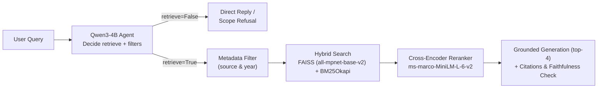

# agentic-hybrid-rag

Agentic hybrid Retrieval-Augmented Generation (RAG) pipeline over five landmark LLM research papers — combining **FAISS dense search**, **BM25 lexical search**, **Cross-Encoder reranking**, **metadata pre-filtering**, **agentic query routing**, and **RAGAs evaluation**.

---

## Architecture



---

## Results

### End-to-End Evaluation (`RAGAs`, judge: `gpt-4o-mini`)

| Metric / Check | Score / Outcome | Notes |
| --- | --- | --- |
| **RAGAs Faithfulness** | **0.89** (`0.8889`) | LLaMA (`1.00`), DeepSeek-R1 (`1.00`), BERT (`0.67`) |
| **RAGAs Answer Relevancy** | **0.87** (`0.8749`) | LLaMA (`1.00`), BERT (`0.93`), DeepSeek-R1 (`0.69`) |
| **Dense-only vs. Hybrid Retrieval** | `0/3` $\rightarrow$ **Rank 1 (`2.63`)** | Pure FAISS missed the LLaMA `SwiGLU` chunk in top 3; Hybrid + Cross-Encoder ranked it #1 |
| **Agentic Routing & Abstention** | Passed | Skips retrieval on greetings/off-topic queries; abstains on impossible filters (`DeepSeek` + `2018`) |

> **Diagnostic insight from RAGAs:** On the BERT pre-training question, RAGAs flagged `0.67` faithfulness because the retrieved chunk truncated right before *Next Sentence Prediction* — the generator filled in the second task from parametric memory rather than retrieved context. Passing numbered chunks to the judge also improved faithfulness measurement from `0.63` $\rightarrow$ `0.89` by fixing citation alignment.

---

## Knowledge Base

Downloads and indexes 5 arXiv papers (`798` overlapping chunks with `source` and `date` metadata):

| Paper | Source | Date |
| --- | --- | --- |
| *Attention Is All You Need* (`1706.03762`) | Google Brain | 2017-06-12 |
| *BERT: Pre-training of Deep Bidirectional Transformers* (`1810.04805`) | Google AI | 2018-10-11 |
| *Language Models are Few-Shot Learners* (`2005.14165`) | OpenAI | 2020-05-28 |
| *LLaMA: Open and Efficient Foundation Language Models* (`2302.13971`) | Meta AI | 2023-02-27 |
| *DeepSeek-R1: Incentivizing Reasoning Capability via RL* (`2501.12948`) | DeepSeek | 2025-01-22 |

---

## Run

Designed for a **T4 GPU** (Colab or local CUDA) in [`notebooks/agentic_hybrid_rag.ipynb`](notebooks/agentic_hybrid_rag.ipynb):

```bash
python -m venv .venv
.venv\Scripts\activate          # macOS/Linux: source .venv/bin/activate
pip install -r requirements.txt
jupyter lab notebooks/agentic_hybrid_rag.ipynb
```

Set `OPENAI_API_KEY` if running the optional `RAGAs` evaluation cell (`RUN_RAGAS = True`); retrieval and `Qwen/Qwen3-4B` generation run locally on GPU.

---

## Layout

```text
.
├── notebooks/
│   └── agentic_hybrid_rag.ipynb    # End-to-end pipeline, tests & RAGAs eval (outputs saved)
├── LICENSE
└── requirements.txt
```
